# Arquitectura y mapa de integración

```mermaid
flowchart LR
  TG[Telegram /nuevo /estado botones] --> W1[n8n WF1: Telegram Trigger único]
  W1 --> GR[Guardrails: usuario, longitud, inyección, deduplicación]
  GR --> CC[Crear caso_id + tabla casos]
  CC --> ORQ
  subgraph WF2 [n8n WF2: Orquestador y agentes]
    ORQ[Orquestador: plan y presupuesto] --> AD[Adaptador: carga skills y catálogo desde Pages]
    AD --> A1[A1 Recepción] --> A2[A2 Catálogo] --> A3[A3 Cotizador + reglas deterministas] --> A4[A4 Revisor]
    A4 -- devuelto, máx 3 --> A3
    A4 -- aprobado --> FIN[Cierre: estado + costos + traza]
  end
  FIN --> REG[Actualizar casos + insertar costos]
  REG --> AP[Telegram: botones Aprobar/Rechazar]
  AP --> DEC[Validar usuario, versión, nonce, vencimiento] --> REG2[Registrar decisión + notificar]
  REG2 -. exportación CSV .-> EXP[scripts/exportar_sanitizado.py]
  EXP --> GH[GitHub: commit] --> GA[Actions: valida] --> GP[Pages: panel + widget]
  GP --> EL[Widget ElevenLabs] --> TOOL[Herramienta de servidor con encabezado secreto]
  TOOL --> W3[n8n WF3: Webhook voz] --> CC
  W3 --> CONS[Consultar folio en tabla casos]
```

**El mismo `caso_id`** (`PS-AAAAMMDD-XXXX`) viaja por: mensaje de Telegram → tabla `casos` → contrato del orquestador → salidas de los 4 agentes → filas de `costos` → botones (`ap|caso|versión|nonce`) → panel público → respuesta de la voz.

## Dónde corre cada componente
| Componente | Dónde | Zona |
|---|---|---|
| Bot de Telegram | Servidores de Telegram → webhook de n8n | Privada (token) |
| WF1, WF2, WF3 y tablas `casos`/`costos` | n8n (Cloud o autohospedado con HTTPS) | Privada |
| Modelo | Gemini API (`gemini-3.1-flash-lite`, compatible con OpenAI) | Privada (API key) |
| Panel HTML + `panel.json` + skills + catálogo | GitHub Pages | Pública (solo ficticio y agregado) |
| Validación y despliegue | GitHub Actions | — |
| Agente de voz | ElevenLabs (widget público + herramienta de servidor) | ID público; secreto del webhook privado |

## Por qué cada especialista es necesario
| Rol | Recibe | Aporta | Sin él… |
|---|---|---|---|
| Orquestador | Contrato de entrada | Orden, límites, detección de fallas, cierre | Nadie detiene un caso inválido |
| A1 | Texto libre | Partidas estructuradas o pregunta | No hay datos medibles |
| A2 | Partidas | SKUs verificados con precio/existencia del catálogo | Se inventarían productos o precios |
| A3 | Líneas + cálculo | Propuesta legible con supuestos | El cliente recibe solo números |
| A4 | Propuesta + solicitud | Bloqueo o aprobación con correcciones | Se liberan errores y promesas indebidas |
